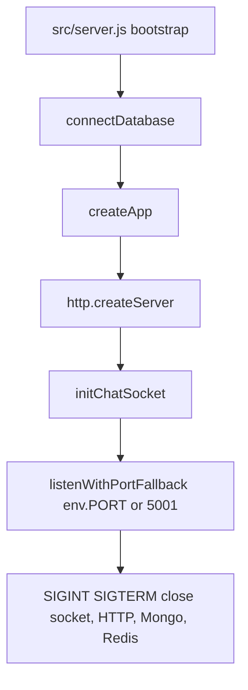

# BuiltGlory service architecture

Reference for `BG-Service` as it is implemented. The workspace spec in the parent `ARCHITECTURE.md` describes a different service (Mineral Bridge: Express 4, TypeScript, in-memory sample catalog, port 3333). This file records the BuiltGlory API after that spec was compared with this codebase. Application code is unchanged.

Package `builtglory-backend`, version 1.0.0. Node.js 20+, Express 5, ES modules, Mongoose. Entry: `src/server.js`. Preferred port: `5001`, with fallback to the next free port.

## What the parent spec assumes, and what this service does

| Parent spec | This service |
| --- | --- |
| TypeScript, CommonJS, Zod, port 3333 | JavaScript ES modules, Joi, port 5001 |
| `src/server.ts` listens only; no database | `src/server.js` connects MongoDB, attaches Socket.IO, then listens |
| In-memory sample array; mongoose installed and unused | Mongoose models, soft delete, Redis for tokens and job locks |
| One router, `GET /api/samples` | Feature modules mounted in `src/routes.js` under `/api/v1` |
| Health at `GET /api/health` | `GET /health`, `GET /ready`, `GET /metrics` |
| Error module missing from the tree | `src/shared/errors/AppError.js` and `src/middleware/errorHandler.js` |
| No auth, rate limit, or request id | JWT customer and admin auth, rate limits, `x-request-id` |

## Stack

| Concern | Choice |
| --- | --- |
| Runtime | Node.js `>=20`, `"type": "module"` |
| HTTP | Express 5 |
| Database | MongoDB through Mongoose 9 |
| Cache and locks | Redis through ioredis. Host and port come from `REDIS_URL` or `REDIS_HOST` / `REDIS_PORT` / `REDIS_PASSWORD`. An in-memory map is used only when Redis is unset or `REDIS_ENABLED=false`. Production requires Redis |
| Validation | Joi 18, applied by `src/middleware/validate.js` |
| Auth | jsonwebtoken access and refresh tokens, bcryptjs for admin passwords |
| Security headers | Helmet 8 |
| CORS | `cors` 2.8, origins from `CORS_ORIGINS`, credentials enabled |
| Rate limit | express-rate-limit |
| Compression | compression |
| Cookies | cookie-parser |
| Config | dotenv 17 plus a Joi env schema in `src/config/env.js` |
| Logging | Winston JSON to the console |
| Files | AWS S3 (`@aws-sdk/client-s3`) and multer uploads |
| Payments | Razorpay webhook and token payments |
| Push | firebase-admin, with optional HTTP push provider |
| Email and SMS | nodemailer, Spear UC / SMS vendor HTTP gateway |
| Realtime | Socket.IO 4 on the same HTTP server |
| API docs | swagger-ui-express plus a generated OpenAPI document |
| Tests | Jest, supertest, mongodb-memory-server |

`express-validator` is installed and unused. `node-cron` schedules the job queue every 15 minutes from `src/server.js`. `npm run jobs:run` still runs the same jobs once.

## Process model



Startup order in `src/server.js`:

1. Register `SIGINT` and `SIGTERM`. On Unix, `SIGUSR2` shuts down without exiting so nodemon can respawn.
2. `connectDatabase()` using `MONGODB_URI`.
3. `createApp()` builds the Express app.
4. `http.createServer(app)` and `initChatSocket(server)`.
5. `listenWithPortFallback` binds the preferred port, then the next free port on `EADDRINUSE` (up to 100 attempts).

Shutdown waits at most 10 seconds. It closes Socket.IO, closes the HTTP server and idle connections, disconnects Mongoose, then quits Redis.

## HTTP pipeline

`src/app.js` middleware order:

1. `requestContext` — `x-request-id` or a new UUID, stored on `res.locals.requestId`
2. `requestLogger` — duration, status, actor, and in-process metrics
3. `helmet()`
4. `compression()`
5. `cors` with comma-split `CORS_ORIGINS`, or any origin when that value is empty, `credentials: true`
6. `cookieParser()`
7. `express.raw` on `POST /api/v1/payments/webhook` so the Razorpay body stays a buffer
8. `express.json` with a 2mb limit
9. `express.urlencoded`
10. `mongoSanitize` — strips keys that start with `$` or contain `.`
11. `generalLimiter` — 1000 requests / 15 minutes in production; skipped in development and test
12. Operational routes, then API routers
13. `notFoundHandler`
14. `errorHandler`

Operational routes, mounted before `/api`:

| Method and path | Body |
| --- | --- |
| `GET /health` and `GET /` | `{ "status": "ok", "uptimeSeconds": <number> }` |
| `GET /ready` | `{ "status": "ready", "checks": { "api": "ok", "memory": "ok" } }` |
| `GET /metrics` | In-process counters, histograms, uptime, and memory |
| `GET /openapi.json` | OpenAPI document from `src/docs/openapi.js`. Hidden when `NODE_ENV=production`. |
| `GET /api-docs` | Swagger UI. Hidden when `NODE_ENV=production`. |

API mounts:

- `app.use("/api/signin", signinRoutes)` — phone OTP at `/api/signin/*`
- `app.use("/api/v1", routes)` — every feature router, including a second mount of signin at `/api/v1/signin/*`

`src/routes.js` is the only place that mounts feature routers under `/api/v1`. Each module router owns its own path prefixes (`/properties`, `/admin/...`, `/me/...`).

## Response and errors

Success helpers in `src/shared/response.js`:

```json
{ "data": {}, "meta": { "requestId": "uuid", "page": 1, "limit": 20, "total": 0, "totalPages": 0 } }
```

`ok` is 200. `created` is 201. `noContent` is 204 with an empty body.

`AppError` (`src/shared/errors/AppError.js`) carries `statusCode`, `code`, `details`, and `isOperational`. Factories: `badRequest` (400 `VALIDATION_ERROR`), `unauthorized` (401), `forbidden` (403), `notFound` (404), `conflict` (409), `domainError` (422 `DOMAIN_RULE_VIOLATION`).

Error body from `src/middleware/errorHandler.js`:

```json
{
  "error": {
    "code": "VALIDATION_ERROR",
    "message": "One or more fields are invalid.",
    "details": [{ "field": "body.phone", "message": "..." }]
  },
  "meta": { "requestId": "uuid" }
}
```

Mongo duplicate-key errors (`11000`) are mapped to 409 `CONFLICT` before the generic handler. Unknown exceptions become 500 `INTERNAL_SERVER_ERROR` with the message "Unexpected server error." Rate-limit responses use the same envelope with code `RATE_LIMITED`.

Controllers reach the error middleware through `asyncHandler`, which forwards rejected promises to `next`. Express 5 also forwards thrown errors from async route handlers.

## Configuration

`src/config/env.js` loads dotenv and validates `process.env` with Joi at import time. Invalid config throws before listen. Unknown keys are allowed.

| Variable | Rule | Default |
| --- | --- | --- |
| `NODE_ENV` | `development`, `test`, `staging`, `production` | `development` |
| `PORT` | number | `5001` |
| `MONGODB_URI` | required in production | `mongodb://127.0.0.1:27017/builtglory` |
| `MONGODB_DNS_SERVERS` | comma-separated, used for `mongodb+srv` | empty |
| `JWT_ACCESS_SECRET` | min 24 chars, required in production | dev placeholder |
| `JWT_REFRESH_SECRET` | min 24 chars, required in production | dev placeholder |
| `JWT_ISSUER` | string | `builtglory-api` |
| `JWT_AUDIENCE` | string | `builtglory-clients` |
| `JWT_ACCESS_EXPIRES_IN` | duration string | `15m` |
| `JWT_REFRESH_EXPIRES_IN` | duration string | `30d` |
| `ADMIN_INACTIVITY_SECONDS` | number; admin access-token lifetime | `1800` |
| `OTP_EXPIRES_SECONDS` / `OTP_RESEND_SECONDS` / `OTP_MAX_ATTEMPTS` | numbers | `300` / `60` / `5` |
| `REDIS_ENABLED` | `false` only in development/test | unset (enabled when a target is configured) |
| `REDIS_URL` | required in production unless `REDIS_HOST` is set; production must be `rediss://` | empty |
| `REDIS_HOST` / `REDIS_PORT` / `REDIS_PASSWORD` | used when `REDIS_URL` is empty | host empty, port `6379`, password empty |
| `REDIS_CONNECT_TIMEOUT_MS` | connection timeout | `10000` |
| `REDIS_MAX_RECONNECT_ATTEMPTS` | fast exponential retries, then a slow probe | `8` |
| `REDIS_RECONNECT_PROBE_MS` | delay between probes after the fast retries stop | `15000` |
| `CORS_ORIGINS` | required in production | empty |
| `AWS_REGION` / `AWS_S3_BUCKET` / keys | S3 | region `ap-south-1` |
| `RAZORPAY_KEY_ID` / `RAZORPAY_KEY_SECRET` / `RAZORPAY_WEBHOOK_SECRET` | webhook secret required in production | empty |
| `SMS_DELIVERY_MODE` | `vendor` or `log` | `vendor` |
| `SMS_VENDOR_URL` | Spear UC gateway. Credentials live only in the environment. | empty |
| `SMTP_*` / `EMAIL_FROM` | nodemailer | `admin@builtglory.com` |
| `FIREBASE_*` | Admin SDK for push | project `builtglory-properties` |
| `APP_*` / `COMPANY_*` | public app config | see `env.js` |

Mongo connects with a pool of 10, 30s server selection, and TLS when the URI is `mongodb+srv://`. Credentials are redacted in connection-error logs.

## Auth and permissions

`src/middleware/auth.js`:

- Access tokens are JWTs signed with `JWT_ACCESS_SECRET`, issuer, and audience. Customer lifetime is `JWT_ACCESS_EXPIRES_IN`. Admin lifetime is `ADMIN_INACTIVITY_SECONDS`.
- Refresh tokens use `JWT_REFRESH_SECRET`.
- Logout writes a SHA-256 of the access token to Redis (`access:blacklist:<hash>`) until the token expires.
- `authenticate("customer" | "admin")` loads the `User` or `Admin`, rejects inactive or blocked accounts, and sets `req.actor` to `{ type, id, role, permissions?, sid }`.
- `requirePermission` and `requireAnyPermission` allow `super_admin`, a `*` permission, or the named permission.

Admin roles in `src/constants/enums.js`: `super_admin`, `admin`, `operations`, `support`, `sales_manager`, `sales_executive`, `relationship_manager`, `designer`. Default grants live in `src/constants/permissions.js`.

Permission strings used on routes: `properties.read`, `properties.write`, `properties.publish`, `users.read`, `users.write`, `users.kyc.review`, `users.fema.review`, `enquiries.read`, `enquiries.write`, `acquisitions.read`, `acquisitions.write`, `sales.read`, `sales.write`, `support.read`, `support.write`, `admin.access.manage`, `audit.read`.

Extra limiters: `authLimiter` (25 / 15 min), `otpLimiter` (8, keyed by phone or email), `emailOtpLimiter` (6), `uploadLimiter` (50). Development and test use higher caps. The general limiter is skipped entirely outside production.

## Folder layout

```text
src/
  server.js                  # bootstrap, signals, port fallback
  app.js                     # Express app and middleware
  routes.js                  # mounts feature routers under /api/v1
  config/                    # env, database, redis, logger
  constants/                 # enums, permissions, notification catalog
  middleware/                # auth, validate, errors, rate limit, sanitize, request context
  shared/                    # factories, AppError, workflows, pagination, transactions
  modules/<feature>/         # route, controller, service, repository, model, schema, validator
  services/                  # cross-module: storage, notifications, payments, audit, firebase
  realtime/chatSocket.js     # Socket.IO
  jobs/                      # batch jobs and CLI runner
  docs/                      # OpenAPI builder
  tests/                     # Jest
  utils/findAvailablePort.js
scripts/                     # seed, migrate, tunnel, push checks
openapi.json
```

A feature module typically owns:

| File | Role |
| --- | --- |
| `route.js` | Express router, auth, permission, and validation middleware |
| `controller.js` | `createController(service)` or custom actions |
| `validator.js` | Joi schemas for body, query, and params |
| `service.js` | Use cases. Starts from `createService` and adds domain methods |
| `repository.js` | `createRepository(Model)` plus custom queries |
| `schema.js` | Mongoose field definitions and indexes |
| `model.js` | Schema, timestamps, soft-delete plugin, model export |
| `permissions.js` | `{ read, write }` permission names for the module |
| `swagger.js` | Paths merged into the OpenAPI document |

Signin is thinner: route, controller, service, validator. Search, app config, edit locks, and admin settings omit some of the standard files. Auth also keeps parallel `auth.*.js` files for email OTP.

The parent spec’s module files (`<feature>.routes.ts`, `.validation.ts`, `.error.ts`) correspond here to `route.js`, `validator.js`, and the shared `AppError` plus `src/middleware/errorHandler.js`. Module-specific error classes are not used.

## Request path

A typical admin list:

1. Router matches, for example `GET /api/v1/admin/visits`.
2. `authenticate("admin")` sets `req.actor`.
3. `requirePermission(...)` checks the role grant.
4. `validate(schema)` runs Joi with `stripUnknown` and writes the parsed body, query, and params back onto the request.
5. `createController` calls `service.list(req.query, req.actor)`.
6. `createRepository.list` applies `isDeleted: { $ne: true }`, pagination (`page` default 1, `limit` default 20, max 100), optional `$text` search, and sort.
7. `ok(res, data, meta)` sends `{ data, meta }`.

`createService` forces an owner filter for customers (`ownerField`), checks workflow transitions through `assertTransition`, writes an audit log, and enqueues in-app plus push notifications on create and status changes. Multi-document work uses `withTransaction`.

Reference ids come from `makeReferenceId` (`BG-ENQ`, `BG-SELL`, `BG-ACQ`, `BG-DEAL`, `BG-VST`, `PROP`, `PAY`, and others).

Soft delete adds `isDeleted`, `deletedAt`, and `deletedBy`. Repositories exclude deleted rows. The plugin is skipped for `admins` and `auditLogs`.

## Modules and public paths

All paths below are under `/api/v1` unless noted.

| Module | Customer | Admin |
| --- | --- | --- |
| `signin` | `POST /api/signin/send-otp`, `verify-otp`, `resend-otp` and the same under `/api/v1/signin` | — |
| `auth` | `POST /auth/customer/otp/send`, `/auth/customer/otp/verify`, `/auth/email/otp/*`, `/auth/refresh`, `/auth/logout` | `POST /auth/admin/login`, session revoke under `/admin/sessions` |
| `users` | `/me`, push token, account deletion | `/admin/users` block, assign, KYC, FEMA, export |
| `admins` | — | `/admin/admins`, `/admin/sales-team`, `/admin/designers` |
| `appConfig` | `GET /app/config` | — |
| `content` | `GET /content`, `GET /content/:slug` | `/admin/content` |
| `adminSettings` | — | `GET` and `PATCH /admin/settings` |
| `properties` | `GET /properties`, save and favorites | `/admin/properties`, media, status, bulk upload, import jobs |
| `search` | `/search/trending`, `/me/searches` | `GET /admin/search` |
| `buyEnquiries` | `/buy-enquiries`, `/me/buy-enquiries` | `/admin/buy-enquiries`, convert to deal |
| `sellRequests` | `/sell-requests`, `/me/sell-requests` | `/admin/sell-requests`, review, create acquisition |
| `visits` | `/visits`, availability, reschedule, cancel | `/admin/visits` status, feedback, call logs |
| `callbacks` | `POST /callbacks` | `/admin/callbacks` |
| `acquisitions` | — | `/admin/acquisitions` stage, valuation, token, payout, convert to property |
| `salesDeals` | — | `/admin/sales/deals` stage, offer, token, payment plan, documentation, close, lost |
| `chatThreads` | — | `/admin/negotiations/chats` |
| `interiorLeads` | — | `/admin/interior/leads` |
| `supportTickets` | `/support/tickets`, `/me/support/tickets`, live chat | `/admin/support/tickets` |
| `appFeedback` | `POST /feedback`, `/me/feedback` | `/admin/feedback` |
| `payments` | `POST /payments/token`, `/me/payments`, `POST /payments/webhook` | `/admin/payments` verify |
| `documents` | `/documents` and upload intents | `/admin/documents` |
| `notifications` | `/me/notifications` | `/admin/notifications`, manual push, retry |
| `communicationLogs` | — | `/admin/communication-logs`, workflow logs, email, push, proofs |
| `editLocks` | — | `/admin/workflow/:entityType/:entityId/lock` |
| `auditLogs` | — | `GET /admin/audit-logs` |
| `reports` | `GET /public/admin-login-stats` | `/admin/reports` summary, analytics, schedules, exports |

Public property list and content do not require a token. Everything else on a customer or admin route calls `authenticate`.

## Workflows

Allowed transitions live in `src/shared/workflows.js`. `assertTransition` throws 409 when the next state is not in the map. Maps: `propertyStatus`, `buyEnquiryStatus`, `sellRequestStatus`, `acquisitionStage`, `salesDealStage`, `visitStatus`, `callbackStatus`, `interiorLeadStatus`, `supportTicketStatus`, `paymentStatus`.

Publishing a property also runs `validatePropertyPublication` (title, description, type, city, locality, pincode, price, cover photo). `requireSuperAdmin` guards actions that name a super-admin approval.

Enum lists that match those maps are in `src/constants/enums.js`.

## Cross-cutting services

| File | Role |
| --- | --- |
| `services/audit.service.js` | Writes audit log rows from workflow changes |
| `services/notification.service.js` | Queue, in-app, and push delivery |
| `services/workflowPush.service.js` | Titles, screens, and deep links per workflow event |
| `services/notificationProviders.service.js` | SMS, email, WhatsApp, and push HTTP providers |
| `services/notificationTemplates.service.js` | Template lookup |
| `services/pushNotification.service.js` | Device push |
| `services/firebase.service.js` | Firebase Admin |
| `services/smsVendor.service.js` | Spear UC SMS |
| `services/storage.service.js` | S3 upload, signed read URLs, 25MB cap, malware scan mode |
| `services/payment.service.js` | Razorpay token payments and webhook checks |
| `services/complianceRules.service.js` | KYC and FEMA style rules |
| `services/legalDocumentRules.service.js` | Document requirements |
| `services/jobLock.service.js` | Redis lock `job:lock:<name>` with a 300s TTL |
| `services/metrics.service.js` | Process-local counters for `GET /metrics` |

## Realtime

Socket.IO is attached in `src/realtime/chatSocket.js` to the same HTTP server. Clients send the access token in `handshake.auth.token` or `Authorization: Bearer`. The handshake uses the same JWT verify, Redis blacklist, and user or admin lookup as HTTP auth.

Rooms: `support:<ticketId>` and `sell:<sellRequestId>`. Client events include `support` join, send, and read, plus `sell:join` and `sell:send`. The server emits `support:message:new`, `support:message:read`, and seller activity updates. HTTP ticket mutations call `publishSupportTicket` so REST and socket clients stay in sync.

## Jobs

`npm run jobs:run` executes `src/jobs/runner.js`: connect Mongo, `runAllJobs()`, disconnect. Each job takes `withJobLock` and skips when the lock is held.

Jobs in `src/jobs/index.js`:

- Mark overdue callbacks
- Raise priority of overdue support tickets
- Enqueue visit reminders (next 24 hours) and visit follow-ups
- Enqueue deal follow-ups
- Retry the notification queue
- Reset pending or failed document scans to pending
- Recalculate `daysInStage` on open acquisitions and sales deals

## Scripts

| Script | Command |
| --- | --- |
| `npm run dev` | nodemon on `src/server.js`, watching `src`, ignoring tests and scripts |
| `npm start` | `node src/server.js` |
| `npm test` | Jest in-band with the ESM VM flag |
| `npm run test:coverage` | Jest with coverage |
| `npm run openapi` | Regenerate OpenAPI from module swagger files |
| `npm run jobs:run` | One-shot job runner |
| `npm run seed` | Seed data |
| `npm run migrate` | Migrations |
| `npm run dev:tunnel` | Cloudflare tunnel helper |

## How to add a feature

1. Create `src/modules/<feature>/` with `schema.js`, `model.js` (soft-delete plugin and timestamps), `repository.js`, `service.js`, `controller.js`, `validator.js`, `permissions.js`, `route.js`, and `swagger.js`.
2. Build the service with `createService` when the resource is a standard owned document with a status or stage. Put extra rules in the module service, and throw `AppError` factories. Do not write HTTP JSON from the service.
3. Declare routes on the module router with full path prefixes (`/me/...` or `/admin/...`). Put `authenticate`, `requirePermission` or `requireAnyPermission`, and `validate` on the route.
4. Mount the router once in `src/routes.js`.
5. Add the status map to `src/shared/workflows.js` and the enum to `src/constants/enums.js` when the resource has a lifecycle.
6. Add a reference-id prefix in `src/shared/id.js` when the resource is user-visible.
7. Add permission strings to `src/constants/permissions.js` and to `ROLE_PERMISSIONS` when admins should receive them by role.
8. Export swagger paths so `npm run openapi` picks them up.

## Boundaries

- Customer and admin are separate token types. A customer token cannot call an admin route.
- CORS is browser origin control. Mobile clients send a bearer token.
- Redis is required in production for token blacklist, OTP, rate limits, and job locks. Local development uses a process-local `Map` only when Redis is unset or `REDIS_ENABLED=false`. A configured Redis that is down does not switch those checks to memory: the process stays up, logs the target, and the critical calls fail until Redis reconnects.
- Metrics and the rate limiter are in-process. They do not span multiple API instances.
- Jobs do not run inside the API process. Schedule `npm run jobs:run` outside the server.
- The payment webhook is the only route that reads a raw JSON body. It is registered before `express.json`.
- Soft-deleted documents stay in Mongo and are filtered by repositories.
